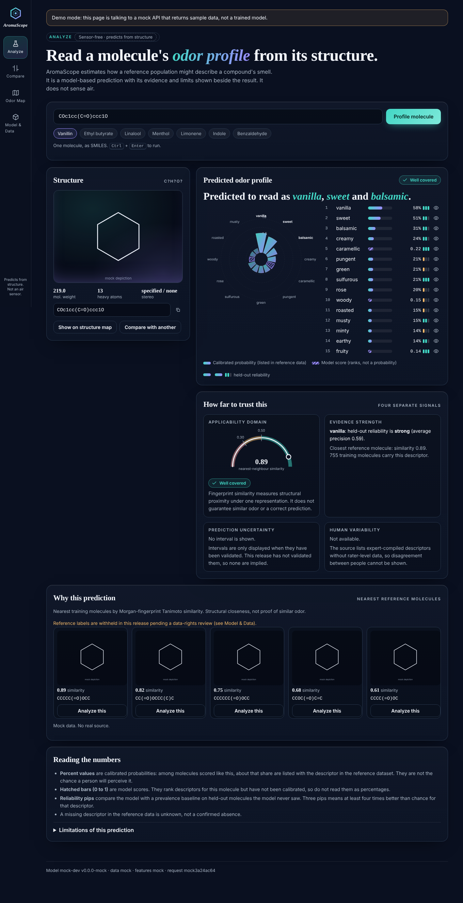

# AromaScope

**Sensor-free digital olfaction.** Paste one molecule as SMILES and get a ranked odor-descriptor profile, with the score type, applicability domain, nearest reference molecules and limitations shown beside the result. It predicts from structure; it does **not** sense air.



## Quick start
```bash
make setup data train     # needs Python 3.12; or let GitHub do it (docs/DEPLOY.md)
make serve                # http://localhost:8000
```
Work on the interface without RDKit: `make dev-ui` (mock API, shows a "Demo mode" banner).

## Architecture (see docs/ARCHITECTURE_CHANGES.md for deviations)
```
apps/web/          static client: Analyze, Compare, Odor Map, Model & Data
services/api/      FastAPI: /api/v1/predictions, /model, /map, /health/{live,ready}
src/aromascope/    chemistry (shared policy + features), bundle (checksums), predictor (domain, evidence, explanations)
ml/                data ledger, scaffold splits, baselines, calibration, domain thresholds, release assembly
artifacts/releases versioned, checksummed bundles (the API refuses to serve an unverified one)
```
Offline path: `build_dataset` -> scaffold split -> prevalence baseline, logistic regression, random forest -> choose on validation -> per-label calibration (gated on held-out data) -> domain thresholds -> frozen test report -> release bundle. Training is never triggered by a request.

## Honesty features
- Score types are explicit: calibrated probability vs uncalibrated model score (hatched).
- Applicability domain, evidence strength, prediction uncertainty and human variability are separate; absent signals say so.
- The model abstains out of domain instead of guessing. Invalid or unsupported input returns a typed error, never a fabricated prediction.
- The map is a structure projection, not a perceptual space. No raw SMILES in logs.

## Docs
`docs/DEPLOY.md` (GitHub + hosting) · `docs/dataset_card.md` · `docs/ARCHITECTURE_CHANGES.md` · generated `model_card.md` inside each release.

Code: MIT. Data: governed by its own terms (see the dataset card).
